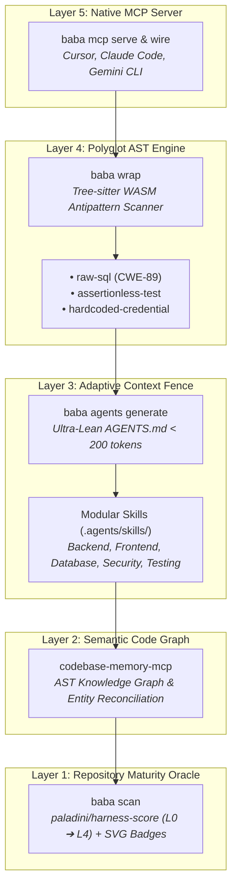

<div align="center">

# 🪆 Matryoshka-Harness
### The Concentric Context-Fencing Engine & L4 Maturity Remediation for Autonomous Coding Agents

[](https://www.npmjs.com/package/@maiquelleonel/matryoshka)
[](https://opensource.org/licenses/MIT)
[](https://bun.com)
[](https://www.typescriptlang.org/)
[](https://tree-sitter.github.io/)
[](https://ouroboros.leonellabshq.dev)

<br/>

**Stop the AI-Slop Tax.** Monolithic instruction prompts waste tokens and dilute LLM attention.  
Matryoshka wraps codebases in **five concentric governance layers**, compiling ultra-lean `AGENTS.md` boundaries (< 200 tokens) and enforcing deterministic Tree-sitter WASM antipattern rules in sub-15ms.

[Documentation](https://matryoshka-harness.leonellabshq.dev/docs/) • [Live Hotsite](https://matryoshka-harness.leonellabshq.dev) • [Contributing](CONTRIBUTING.md) • [Security](SECURITY.md) • [Architecture](docs/guide/concepts/concentric-layers.md)

</div>

---

## ⚡ Zero-Install Quickstart

Run directly without installing any package via `bunx` or `npx`:

```bash
# Analyze AST antipatterns & generate DIAGNOSTIC.md remediation
bunx @maiquelleonel/matryoshka wrap

# Audit repository maturity (L0 - L4) & generate SVG badge
npx @maiquelleonel/matryoshka scan --badge

# Compile ultra-lean root AGENTS.md (< 200 tokens) with on-demand skills
bunx @maiquelleonel/matryoshka agents generate --dry-run

# Auto-wire native codebase-memory-mcp into Cursor, Claude, and Gemini CLI
bunx @maiquelleonel/matryoshka mcp wire
```

### Triple Binary Aliases Parity

Every command is executable through three official ergonomic aliases with 100% feature parity:

* **`baba`** — The Slavic matriarch of nesting dolls (4 letters, zero typos). Recommended for day-to-day terminal ergonomics.
* **`bbyg`** — Baba-Yaga mythology shorthand for high-velocity silicon agent sandboxes.
* **`matryoshka`** — Formal canonical package name for corporate CI/CD pipelines.

```bash
# All three invocations are byte-for-byte identical:
baba scan --json
bbyg scan --json
matryoshka scan --json
```

---

## 🏛️ The Russian Doll Mental Model (5 Concentric Layers)

Like a traditional Russian Matryoshka doll, each governance layer tightly encapsulates and shields the next, progressively fencing context from the outermost IDE tool surface down to foundational repository hygiene:

```text
+-----------------------------------------------------------------+
| LAYER 5: Native MCP Server (baba mcp serve / wire)              |
| - stdio JSON-RPC 2.0 protocol for Cursor, Claude Code,          | 
|   Zed & GeminiCLI                                               |
| +-------------------------------------------------------------+ |
| | LAYER 4: Polyglot AST Engine (baba wrap)                    | |
| | - In-memory Tree-sitter WASM inspection in < 200ms          | |
| | - Raw SQL injection, assertionless false-greens,            | |
| |   hardcoded secrets                                         | |
| | +---------------------------------------------------------+ | |
| | | LAYER 3: Adaptive AGENTS.md & Modular Skills            | | |
| | | - Root AGENTS.md strictly under 200 tokens              | | |
| | | - On-demand .agents/skills/*.md with strict             | | |
| | |   YAML frontmatter                                      | | |
| | | +-----------------------------------------------------+ | | |
| | | | LAYER 2: Semantic Code Graph Integration            | | | |
| | | | - Cross-references static file paths                | | | |
| | | | - Reconciles missing governance against             | | | | 
| | | |   actual entities                                   | | | |
| | | | +-------------------------------------------------+ | | | |
| | | | | LAYER 1: Repository Maturity Oracle             | | | | |
| | | | | - Powered by canonical paladini/harness-score   | | | | |
| | | | | - L0 to L4 hygiene scoring & dynamic SVG badges | | | | |
| | | | +--------------------------------------------- ---+ | | | |
| | | +-----------------------------------------------------+ | | |
| | +---------------------------------------------------------+ | |
| +-------------------------------------------------------------+ |
+-----------------------------------------------------------------+
```

### Concentric Governance Flow



---

## 📦 Installation Options

### 1. Zero-Install Execution (Recommended)
```bash
# Run with bunx (sub-15ms startup):
bunx @maiquelleonel/matryoshka <command>

# Run with npx:
npx @maiquelleonel/matryoshka <command>
```

### 2. Standalone Compiled Binaries (Airgapped & Zero-Runtime)
Single standalone executables with bundled Tree-sitter WASM and zero external dependencies:

```bash
# Linux x64
curl -sSL https://github.com/maiquelleonel/matryoshka-harness/releases/download/v0.4.0/baba-linux-x64 -o /usr/local/bin/baba && chmod +x /usr/local/bin/baba

# macOS Apple Silicon (ARM64)
curl -sSL https://github.com/maiquelleonel/matryoshka-harness/releases/download/v0.4.0/baba-darwin-arm64 -o /usr/local/bin/baba && chmod +x /usr/local/bin/baba
```

Available targets: `baba-linux-x64`, `baba-linux-arm64`, `baba-darwin-arm64`, `baba-darwin-x64`, `baba-windows-x64.exe`.

### 3. Global Package Manager
```bash
bun add -g @maiquelleonel/matryoshka
# or
npm install -g @maiquelleonel/matryoshka
```

---

## 🛠️ Complete Actionable CLI Reference

### `baba detect` — Polyglot Stack Discovery
Inspects repository manifests and determines primary programming language, framework ecosystem, test runner, and architectural archetype in under 10ms.

```bash
# Human-readable terminal output:
baba detect

# Structured JSON for agentic pipelines:
baba detect ./services/billing --json
```

**Supported Ecosystems:** TypeScript/JavaScript (Next.js, React, Vue, NestJS), Python (FastAPI, Django, Flask), Go (Gin, Echo, Fiber), Rust (Actix, Axum), Ruby (Rails), PHP (Laravel, Symfony).

---

### `baba scan` — Maturity Audit & SVG Badge
Executes repository hygiene inspection against the canonical `paladini/harness-score` oracle, detecting CI gates, license compliance, testing harnesses, and architectural blueprints.

```bash
# Run audit and output terminal summary:
baba scan

# Generate official SVG compliance badge:
baba scan --badge ./badges/harness.svg

# Output structured JSON:
baba scan --json
```

---

### `baba agents` — Adaptive Context-Fencing & Skills
Combats the prompt bloat crisis by generating an ultra-lean root `AGENTS.md` strictly under 200 tokens, routing domain-specific instructions into on-demand modular skills (`.agents/skills/*.md`) with strict YAML frontmatter.

```bash
# Generate root AGENTS.md and active skills:
baba agents generate

# Preview generated files and token savings without writing to disk:
baba agents generate --dry-run

# Non-destructive overwrite (creates AGENTS.md.bak automatically):
baba agents generate --force

# Inspect architectural seams and recommend archetype governance:
baba agents profile

# Audit existing AGENTS.md against the 250 token hard budget:
baba agents check --json

# Render a specific compiled skill guidance:
baba agents skill backend
baba agents skill database
baba agents skill security
baba agents skill frontend
baba agents skill testing
```

---

### `baba wrap` — Polyglot AST Antipattern Scanner
Analyzes codebases using in-memory Tree-sitter WASM parsers to flag dangerous antipatterns generated by LLMs before code is committed or merged.

```bash
# Run AST audit and compile DIAGNOSTIC.md report:
baba wrap

# Enforce strict CI quality gate (exits with code 1 on failure):
baba wrap --strict --threshold 85

# Custom report location:
baba wrap -o ./reports/AST_AUDIT.md

# Pure JSON output for orchestrator consumption:
baba wrap --json --dry-run
```

**Antipattern Rules Evaluated:**
* `raw-sql` — Detects unparameterized SQL interpolation / string formatting (CWE-89).
* `assertionless-test` — Detects mock-heavy tests without behavioral assertions (`expect`, `assert`).
* `hardcoded-credential` — Detects hardcoded plaintext secrets, API tokens, and private keys.

---

### `baba mcp` — Model Context Protocol Orchestration
Provides seamless integration between AI agent IDEs and the Matryoshka engine.

```bash
# Auto-configure codebase-memory-mcp in Cursor, Claude, and Gemini CLI:
baba mcp wire

# Filter specific IDE targets:
baba mcp wire --targets cursor,claude

# Start native MCP server over stdio for direct agent attachment:
baba mcp serve
```

#### Exposed MCP Tools:
* `detect_stack` — Polyglot language and framework inspection.
* `scan_harness` — Maturity level assessment (L0 to L4) and gap evaluation.
* `generate_agents` — Adaptive AGENTS.md compilation and modular skill provisioning.
* `wrap_context` — In-memory AST antipattern verification and remediation action plan.

---

## 🐍 Ouroboros Engine Heritage & Mathematical Rigor

Matryoshka-Harness was conceived, architected, and continuously validated by the **LeonelLabs Ouroboros Engine** (`https://ouroboros.leonellabshq.dev`).

### The Recursive Autonomous Engineering Thesis
Following the theoretical framework pioneered by Google Cloud AI Research & Northwestern University (*"Harness the agent. Then harness its self-improvement"* — [arXiv:2610.14224](https://arxiv.org/abs/2610.14224)):

1. **Formal Recursive Convergence:**  
   $$\mathcal{H}_{t+1} = \text{Compose}(\text{Probe}(\text{Propose}(\mathcal{H}_t)))$$  
   The harness continuously evolves by contrasting empirical agent execution traces against mathematical governance constraints.
2. **Deterministic Anti-Slop Safeguards:**  
   Eliminating hallucinated tests, bloated monolithic context prompts, and gratuitous design pattern anti-patterns before code reaches human review.
3. **Shared-Nothing Hermetic Sandboxes:**  
   All builds and tests execute inside zero-egress, air-gapped sandboxes with deterministic offline dependency caches.

Visit the [LeonelLabs Ouroboros Engine Portal](https://ouroboros.leonellabshq.dev) to explore autonomous software factory blueprints and multi-agent systems orchestration.

---
---

## 🔒 Security & Privacy Invariants

* **Zero Code Exfiltration:** 100% of AST analysis, Tree-sitter WASM traversal, and manifest parsing executes locally in-process. Zero bytes of source code or diffs ever leave your machine.
* **Non-Destructive Overwrites:** `baba agents generate` guarantees backup preservation (`AGENTS.md.bak`) and strictly refuses destructive overwrites without explicit `--force` confirmation.
* **Hermetic Stream Isolation:** The native MCP server strictly enforces stream hygiene—newline-delimited JSON-RPC 2.0 frames remain strictly on `stdout`, while diagnostic logs and startup telemetry are routed exclusively to `stderr`.
* **Security Policy & Vulnerability Disclosure:** For supported release lines, responsible disclosure protocols, and cryptographic verification, review [SECURITY.md](SECURITY.md).

## 🤝 Contributing

We welcome community contributions, bug reports, and new Tree-sitter AST rules! Please review our [CONTRIBUTING.md](CONTRIBUTING.md) guide before submitting pull requests.

Distributed under the **MIT License**. See [LICENSE](LICENSE) for complete terms.

**Author & Maintainer:** [Maiquel Leonel](https://maiquelleonel.com.br)  
**Engineering Pod:** LeonelLabs Autonomous Systems Group  
**Canonical Repository:** [maiquelleonel/matryoshka-harness](https://github.com/maiquelleonel/matryoshka-harness)
