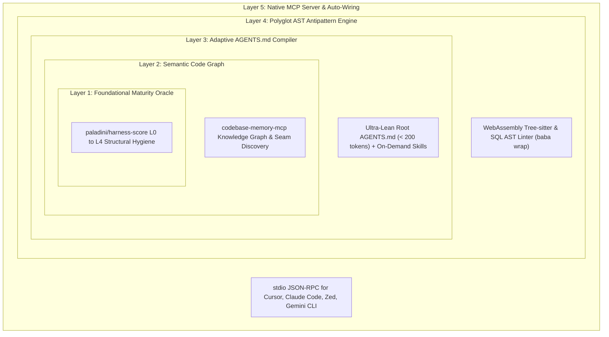

# 🪆 Matryoshka-Harness

> **Adaptive Context-Fencing, Anti-Slop `AGENTS.md` Compiler & L4 Maturity Remediation for Autonomous Coding Agents**

[](https://ouroboros.leonellabshq.dev)
[](https://www.npmjs.com/package/@maiquelleonel/matryoshka)
[](LICENSE)
[](https://bun.com)
[](site/index.html)

---

## ⚡ The Crisis: Context-Rot & AI Slop in Autonomous Coding

Autonomous AI coding agents (Claude Code, Cursor, Zed, Gemini CLI, Aider) are transforming software engineering. However, unconstrained LLMs rapidly degrade codebases through **Context-Rot** and the **AI Slop Tax**:

- 💸 **Token Bloat & Context Exhaustion:** Giant monolithic prompts (> 1,000 tokens) consume context windows, causing models to hallucinate, forget instructions, and burn API credits.
- 🎭 **False-Green Test Suites:** AI agents create fragile, mock-heavy tests that pass the terminal runner while asserting **zero** real behavioral invariants.
- 🕳️ **Architectural Drift & Forced Patterns:** Agents invent alien architectural patterns (such as forced SOLID in procedural WordPress/Drupal or microservice abstractions in tiny monoliths).
- 🔓 **Security Vulnerabilities:** Unchecked generation of dynamic SQL string interpolations, hardcoded secrets, and missing input sanitization.

**Matryoshka-Harness** solves this by wrapping repositories in **five concentric layers of deterministic governance**, compiling ultra-lean `< 200 token` `AGENTS.md` files, inspecting syntax trees via WebAssembly Tree-sitter, and serving as a native Model Context Protocol (MCP) server.

---

## 🏛️ The Concentric Architecture (The Russian Doll Model)

Like the traditional Russian Matryoshka doll, each governance layer tightly encapsulates and protects the inner core of your codebase:

```text
       ┌─────────────────────────────────────────────────────────┐
       │ Layer 5: Native MCP Server (baba mcp serve / wire)      │
       │  ┌───────────────────────────────────────────────────┐  │
       │  │ Layer 4: Polyglot AST Engine (baba wrap)          │  │
       │  │  ┌─────────────────────────────────────────────┐  │  │
       │  │  │ Layer 3: Adaptive AGENTS.md (< 200 tokens)  │  │  │
       │  │  │  ┌───────────────────────────────────────┐  │  │  │
       │  │  │  │ Layer 2: Semantic Code Graph (MCP)    │  │  │  │
       │  │  │  │  ┌─────────────────────────────────┐  │  │  │  │
       │  │  │  │  │ Layer 1: Core Maturity Oracle   │  │  │  │  │
       │  │  │  │  │         (harness-score L1-L4)   │  │  │  │  │
       │  │  │  │  └─────────────────────────────────┘  │  │  │  │
       │  │  │  └───────────────────────────────────────┘  │  │  │
       │  │  └─────────────────────────────────────────────┘  │  │
       │  └───────────────────────────────────────────────────┘  │
       └─────────────────────────────────────────────────────────┘
```



### 1. Layer 1 — Repository Maturity Oracle (`baba scan`)
Audits foundational hygiene against canonical industry benchmarks powered by `paladini/harness-score` (CI quality gates, licensing, test coverage, documentation) with graceful in-memory fallback. Generates official SVG compliance badges.

### 2. Layer 2 — Semantic Code Graph Integration (`codebase-memory-mcp`)
Bridges static filesystem hierarchies with active knowledge graphs. Discovers architectural seams (routes, models, controllers, services, views) before any agent executes code modifications.

### 3. Layer 3 — Adaptive `AGENTS.md` & Modular Skills (`baba agents`)
Eliminates context bloat by generating an ultra-lean root `AGENTS.md` strictly bounded to `< 200 tokens`. Routes specialized domain rules (Backend, Frontend, Database, Security, Testing) into `.agents/skills/*.md` with YAML frontmatter, loaded strictly on-demand.

### 4. Layer 4 — Polyglot AST Engine & Remediation (`baba wrap`)
Runs zero-host-dependency WebAssembly Tree-sitter parsers across TypeScript, JavaScript, Python, Go, and Rust. Detects SQL string interpolations, assertionless tests, and hardcoded credentials. Produces deterministic `DIAGNOSTIC.md` reports with exact line citations.

### 5. Layer 5 — Native MCP Server & Auto-Wiring (`baba mcp`)
Connects directly to Cursor, Claude Code, Zed, and Gemini CLI over standard `stdio`. Exposes live tools (`detect_stack`, `scan_harness`, `generate_agents`, `wrap_context`) and resources without filesystem polling.

---

## 🚀 Quickstart (< 30 Seconds, Zero Dependencies)

Matryoshka is published with three interchangeable canonical binary aliases:
- **`baba`** — 4 letters, zero typos, lightning fast in terminal workflows.
- **`bbyg`** — Baba-Yaga mythology (remediation that feels like sorcery).
- **`matryoshka`** — Formal canonical package identity.

### Zero-Install Execution via Bun or Node

```bash
# Using Bun (instant sub-15ms execution)
bunx @maiquelleonel/matryoshka wrap

# Using Node (npx)
npx @maiquelleonel/matryoshka wrap

# With shorthand aliases
bunx @maiquelleonel/baba scan
bunx @maiquelleonel/bbyg agents generate --dry-run
```

### Standalone Precompiled Binaries

Download self-contained native executables for your platform from [GitHub Releases](https://github.com/maiquelleonel/matryoshka-harness/releases):
- `matryoshka-linux-x64` / `matryoshka-linux-arm64`
- `matryoshka-darwin-arm64` (Apple Silicon) / `matryoshka-darwin-x64` (Intel Mac)
- `matryoshka-windows-x64.exe`

Zero Node.js, Bun, Python, or C++ runtime dependencies required.

---

## 🛠️ CLI Reference & Ergonomics

```text
Matryoshka-Harness CLI — v0.4.0
Adaptive Context-Fencing, Anti-Slop AGENTS.md Compiler & L4 Maturity Remediation

Usage:
  baba <command> [arguments] [options]
  bbyg <command> [arguments] [options]
  matryoshka <command> [arguments] [options]

Reconnaissance & Maturity Audit:
  detect [path]               Inspect codebase and detect primary stack, frameworks, and test runner
  scan [path]                 Execute maturity audit (paladini/harness-score oracle) and export SVG badges

Governance & Context-Fencing:
  agents generate [path]      Compile ultra-lean AGENTS.md (< 200 tokens) and modular .agents/skills/
  agents profile [path]       Discover architectural seams and project archetype
  agents check [path]         Audit root AGENTS.md against strict FinOps token budget (< 250 tokens)
  agents skill <name> [path]  Compile specialized skill (backend, frontend, database, security, testing)

Antipattern Remediation & Quality Gates:
  wrap [path]                 Execute AST antipattern analysis, Harness² scoring, and DIAGNOSTIC.md

Agent Context Autowiring & Model Context Protocol:
  mcp wire [path]             Auto-wire codebase-memory-mcp into Cursor, Gemini CLI, and Claude Code
  mcp serve [path]            Start high-performance stdio MCP server for AI IDEs and agents
```

### Common Commands

```bash
# 1. Detect repository stack and archetype
baba detect

# 2. Audit structural hygiene and export official SVG compliance badge
baba scan --badge ./docs/harness-badge.svg

# 3. Compile lean AGENTS.md and modular skills (non-destructive)
baba agents generate --dry-run
baba agents generate --force

# 4. Run polyglot AST audit and compile DIAGNOSTIC.md
baba wrap --strict --threshold 80

# 5. Auto-wire IDE configuration for Cursor and Claude Code
baba mcp wire --targets cursor,claude

# 6. Run native stdio MCP server
baba mcp serve
```

---

## 🛡️ Downstream CI Quality Gate (GitHub Actions)

Enforce deterministic anti-slop verification in downstream repositories by adding this GitHub Actions step to your workflow (`.github/workflows/ci.yml`):

```yaml
name: Quality Gate & Governance

on:
  push:
    branches: [main]
  pull_request:
    branches: [main]

jobs:
  matryoshka-gate:
    runs-on: ubuntu-latest
    steps:
      - name: Checkout Codebase
        uses: actions/checkout@v4

      - name: Setup Bun Runtime
        uses: oven-sh/setup-bun@v2
        with:
          bun-version: latest

      - name: Enforce Anti-Slop AST & Maturity Gate
        run: |
          bunx @maiquelleonel/matryoshka wrap --strict --threshold 80
```

If an agent or contributor introduces unparameterized SQL queries, assertionless test mocks, hardcoded credentials, or drops the composite score below 80, the gate fails immediately and outputs actionable remediation instructions.

---

## 🌐 Interactive Hotsite & Visual Showcase

Experience the concentric Russian doll architecture visually in our interactive web experience:

- 🎮 **Live Interactive Hotsite:** Open [`site/index.html`](site/index.html) locally or visit the hosted hotsite at [ouroboros.leonellabshq.dev](https://ouroboros.leonellabshq.dev).
- Features bidirectional 3D doll unfolding, bilingual internationalization (PT-BR and EN), real-world terminal evidence, and interactive layer inspection.

---

## 🐍 LeonelLabs Ouroboros Heritage

Matryoshka-Harness was developed and verified under the rigorous autonomous engineering standards of the **LeonelLabs Ouroboros Engine**.

> **Built with mathematical rigor by the [LeonelLabs Ouroboros Engine](https://ouroboros.leonellabshq.dev).**  
> Parent Ecosystem: [maiquelleonel/ouroboros](https://github.com/maiquelleonel/ouroboros)

The Ouroboros Engine implements self-improving agentic recursion (Task-Level Recursion: *Propose – Probe – Compose*), continuous FinOps context guardrails, and deterministic Spec-Driven Development (SDD).

---

## 📄 License & Governance

Distributed under the open-source **MIT License**.  
Copyright (c) 2026 **Maiquel Leonel**.

See [LICENSE](LICENSE) for full legal text.
