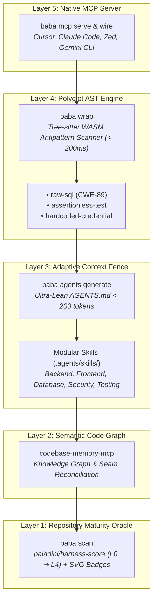

# Concentric Layers (The Russian Doll Mental Model)

Modern autonomous AI coding agents (Claude Code, Gemini CLI, Cursor, OpenAI Codex) possess tremendous synthesis capabilities, yet in real-world software engineering, they frequently trigger what the industry terms the **AI-Slop Crisis**:
* Unconstrained freedom leading to speculative abstractions (inventing unwanted class hierarchies, factory patterns, or enterprise boilerplate where simple functions suffice).
* Context window pollution (dumping massive 1,500-line prompt files that dilute model attention and burn thousands of dollars in input tokens).
* False-green verification (generating tests with mocks that assert nothing, masking breaking changes).
* Silent security regressions (introducing unparameterized dynamic SQL queries or hardcoded tokens).

**Matryoshka-Harness** (`baba` / `bbyg` / `matryoshka`) resolves these vulnerabilities through the **Russian Doll mental model**: wrapping repositories into **five concentric governance layers**. Like traditional nested nesting dolls (*matryoshkas*), each outer layer tightly encapsulates, protects, and constrains the next, shielding the agent's context from the outermost IDE tool surface down to foundational repository hygiene.

---

## 🪆 The 5 Concentric Layers Overview

```text
+-------------------------------------------------------------------------+
| LAYER 5: Native MCP Server (baba mcp serve / wire)                      |
| - stdio JSON-RPC 2.0 protocol for Cursor, Claude Code, Zed & Gemini CLI |
| +---------------------------------------------------------------------+ |
| | LAYER 4: Polyglot AST Engine (baba wrap)                            | |
| | - In-memory Tree-sitter WASM inspection in < 200ms                  | |
| | - Raw SQL injection, assertionless tests, hardcoded secrets         | |
| | +-----------------------------------------------------------------+ | |
| | | LAYER 3: Adaptive AGENTS.md & Modular Skills (baba agents)      | | |
| | | - Root AGENTS.md strictly under 200 tokens (Token Guard < 250)  | | |
| | | - On-demand .agents/skills/<domain>/SKILL.md with strict YAML frontmatter    | | |
| | | +-------------------------------------------------------------+ | | |
| | | | LAYER 2: Semantic Code Graph Integration (codebase-memory)  | | | |
| | | | - Cross-references static file paths with codebase memory   | | | |
| | | | - Reconciles missing governance against actual entities     | | | |
| | | | +---------------------------------------------------------+ | | | |
| | | | |  LAYER 1: Repository Maturity Oracle (baba scan)        | | | | |
| | | | |  - Powered by canonical paladini/harness-score          | | | | |
| | | | |  - L0 to L4 hygiene scoring & dynamic SVG badges        | | | | |
| | | | +---------------------------------------------------------+ | | | |
| | | +-------------------------------------------------------------+ | | |
| | +-----------------------------------------------------------------+ | |
| +---------------------------------------------------------------------+ |
+-------------------------------------------------------------------------+
```

---

## 🏛️ Concentric Governance Architecture Flow

Each layer serves a distinct architectural purpose in the software lifecycle, progressively filtering noise and enforcing deterministic boundaries:



---

## 🔬 Deep Dive: Layer by Layer

### Layer 1: Repository Maturity Oracle (`baba scan`)
The solid innermost core is the **Repository Maturity Oracle**. Before teaching an agent how to write code, the repository must possess foundational structural hygiene:

* **Canonical Engine:** Powered by the open-source `paladini/harness-score` specification.
* **5 Governance Axes:**
  1. **Context:** Presence of architecture blueprints, system maps, and boundary definitions.
  2. **Skills:** Structured agent instructions and skill definitions.
  3. **Guardrails:** Automated linters, formatters, typecheckers, and pre-commit hooks.
  4. **Sensors:** CI/CD pipelines, automated testing harnesses, and telemetry monitors.
  5. **Hygiene:** Open-source licensing (MIT, Apache-2.0), security policies, and README showcases.
* **Scoring Regimes:** Evaluated on a 0 to 105 point scale, mapping repositories into maturity tiers from **Level 0 (Ad-hoc)** to **Level 4 (Autonomous Nirvana)**.
* **Compliance Badging:** Automatically renders accessible, high-contrast SVG badges for display in `README.md`.

```bash
# Audit structural hygiene and export compliance badge:
baba scan --badge ./badges/harness.svg
```

---

### Layer 2: Semantic Code Graph Integration (`codebase-memory-mcp`)
Static files on disk do not tell the whole story. Layer 2 integrates with **`codebase-memory-mcp`** to reconcile static file paths against runtime and semantic reality:

* **Entity Reconciliation:** Cross-references detected files with active database models, API routes, controller endpoints, and dependency trees.
* **Anti-Hallucination Seam Mapping:** When an agent attempts to scaffold a new feature, Layer 2 queries the AST knowledge graph to reveal existing conventions (e.g. existing ORM repositories or query builders) so the agent does not invent duplicated abstractions.
* **Autonomous Seam Profiling:** Discovers whether a repository follows `api_backend`, `opinionated_monolith`, `reactive_frontend`, `systems_microservice`, or `fullstack_hybrid` topologies.

---

### Layer 3: Adaptive AGENTS.md & Modular Skills (`baba agents`)
Layer 3 solves the **Token Bloat** crisis. Dumping a 1,500-line monolithic rules document into every agent prompt wastes budget and guarantees that models disregard instructions:

* **Hyper-Lean Master Fence:** Generates a root `AGENTS.md` strictly under 200 tokens (with a strict Token Guard hard limit of < 250 tokens). It defines archetype identity, canonical test/build/lint commands, and non-negotiable anti-slop rules (YAGNI, DRY, no unprompted refactoring).
* **On-Demand Scoped Skills (`.agents/skills/`):** Decomposes deep domain rules into modular files:
  * `skill-backend.md`: ORM patterns, transaction boundaries, anti-N+1 query rules.
  * `skill-frontend.md`: A11y, Cumulative Layout Shift (CLS) prevention, pure state rendering.
  * `skill-database.md`: Zero-downtime migrations, concurrent index creation, lock timeouts.
  * `skill-security.md`: OWASP Top 10, input sanitization, zero secret leakage.
  * `skill-testing.md`: The Seam Contract (Red-to-Green TDD discipline and mock boundaries).
* **Mandatory YAML Frontmatter:** Every skill embeds `name` and `description` frontmatter. AI assistants index only metadata until a specific skill is needed, reducing token consumption per conversation turn by over 85%.

For a thorough exploration, read the [Adaptive Agents Concept Guide](adaptive-agents.md).

```bash
# Preview adaptive fence compilation with zero disk mutations:
baba agents generate --dry-run
```

---

### Layer 4: Polyglot AST Engine (`baba wrap`)
Regex search and superficial text linters cannot understand code structure. Layer 4 provides in-memory, zero-host-compiler AST inspection powered by **Tree-sitter WebAssembly (WASM)**:

* **Sub-200ms Execution:** Parses polyglot source trees (TypeScript, JavaScript, Python, Go, Rust) in memory without requiring host C/C++ or language toolchains.
* **The 3 Canonical Antipattern Rules:**
  1. **`raw-sql` (CWE-89):** Identifies dynamic string concatenations, template literals, and f-strings fed into database query expressions.
  2. **`assertionless-test`:** Detects empty test functions or test suites that mock dependencies without executing real behavioral assertions (`expect`, `assert`, `t.Fatal`). *(Note: Test suites are excluded by default to optimize latency; pass `--include-tests` to scan test files)*.
  3. **`hardcoded-credential`:** Detects high-entropy string literals (Shannon entropy $H(S) > 3.0$) and recognized secret tokens (`sk_live_`, `ghp_`, `AKIA`) embedded in source nodes.
* **Composite Composite Scoring:** Combines Layer 1 hygiene with Layer 4 AST health:
  ```text
Composite Score = (Base Oracle × 0.4) + (AST Health × 0.6)
```
* **Remediation Compiler (`DIAGNOSTIC.md`):** Deterministically compiles a surgical remediation plan capped strictly under 1,500 tokens.

For complete rule schemas and AST traversal mechanics, read the [Polyglot AST Engine Guide](ast-engine.md).

```bash
# Execute deep AST verification with CI strict quality gate:
baba wrap --strict --threshold 80
```

---

### Layer 5: Native MCP Server (`baba mcp serve` & `wire`)
The outermost shell interfaces directly with human developers and autonomous agents in their IDE of choice via the **Model Context Protocol (MCP)**:

* **stdio JSON-RPC 2.0 Transport:** Operates over standard input/output streams, guaranteeing zero-network-port exposure and mitigating unauthenticated localhost remote code execution (RCE) hazards.
* **Native Tooling Suite:**
  * `detect_stack`: Discovers languages, frameworks, and architecture archetypes.
  * `scan_harness`: Computes L0-L4 maturity level and gap analysis.
  * `generate_agents`: Compiles lean `AGENTS.md` boundaries and modular skills.
  * `wrap_context`: Runs AST antipattern verification and generates `DIAGNOSTIC.md`.
* **Zero-Touch Auto-Wiring:** With a single command (`baba mcp wire`), Matryoshka injects non-destructive MCP configurations into Cursor (`.cursor/mcp.json`), Claude Code (`.claude/mcp.json`), and Gemini CLI (`.gemini/settings.json`).

```bash
# Auto-wire all IDE configurations:
baba mcp wire

# Launch persistent stdio MCP daemon:
baba mcp serve
```

---

## 🛡️ Why Concentric Encapsulation Matters

| Conventional Monolithic Approaches | Matryoshka Concentric Model |
| :--- | :--- |
| Single 1,500-line prompt file loaded on every turn. | Root `AGENTS.md` < 200 tokens; deep skills loaded on-demand. |
| Regex matches that trigger false positives on comments or strings. | Structural Tree-sitter WASM AST inspection across all languages. |
| AI agents generate tests that mock everything and assert nothing. | Layer 4 AST engine flags assertionless tests before merge. |
| Abstract maturity scores with zero actionable guidance. | Layer 4 compiles surgical `DIAGNOSTIC.md` with line-level fixes. |
| Fragmented IDE setup requiring custom scripts per tool. | Standardized stdio MCP server for Cursor, Claude, Zed, and Gemini. |

---

## ⏭️ Next Reading

* [Polyglot AST Engine](ast-engine.md) — Dive into Tree-sitter WASM parsing and contextual rule mechanics.
* [Adaptive Agents & Modular Skills](adaptive-agents.md) — Learn how adaptive context-fencing eliminates prompt bloat.
* [Quickstart Guide](../getting-started/quickstart.md) — 5-minute hands-on walkthrough covering all 5 layers.
