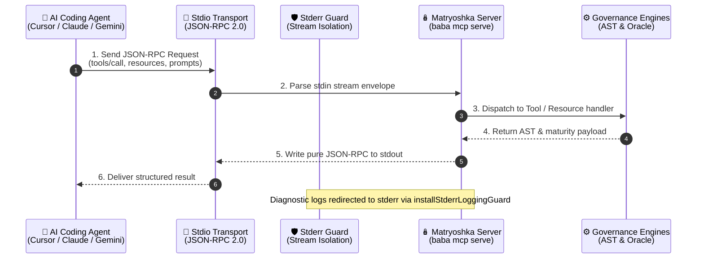

# MCP Server Integration (Model Context Protocol)

Connect Matryoshka-Harness directly into modern AI development environments, code editors, and agent orchestrators through the **Model Context Protocol (MCP)**.

---

## 🚀 Overview

The **Model Context Protocol (MCP)**, open-sourced by Anthropic, establishes an open standard for secure, bi-directional communication between AI coding agents and local developmental toolsets. 

Matryoshka implements a native, zero-runtime-dependency MCP server over standard input/output (**`stdio`**) that conforms strictly to the **JSON-RPC 2.0** protocol specification. Through this interface, AI agents operating in editors such as Cursor, Claude Code, Gemini CLI, and Zed gain immediate, structured access to repository stack intelligence, maturity auditing, adaptive context compilation, and AST vulnerability scanning.

---

## 🏛️ Stdio Transport Architecture & Stream Isolation

In an agentic environment, maintaining stream purity over standard I/O is non-negotiable. Any accidental log statement or debugging trace printed to `stdout` corrupts JSON-RPC frame parsing, severing the agent's connection.

Matryoshka enforces rigorous stream separation:

1. **`stdout` Dedicated Transport:** Strictly reserved for newline-delimited (`\n`) JSON-RPC 2.0 message envelopes.
2. **`stderr` Telemetry & Diagnostics:** All runtime telemetry, progress updates, and operational logs are routed exclusively through `stderr`.
3. **`installStderrLoggingGuard`:** Dynamic monkey-patching wrapper intercepting `console.log`, `console.info`, `console.warn`, and `console.debug`, rewriting output with structured prefixes (`[matryoshka-mcp] [<level>]`) and redirecting it to `stderr`.



---

## 🧰 Native MCP Tools

The Matryoshka MCP server exposes 4 high-signal tools for autonomous agent inspection and remediation:

### 1. `detect_stack`
Discovers the repository's primary programming language, web/application frameworks, test runners, and architectural archetype.

* **Parameters:**
  * `path` *(string, optional)*: Absolute or relative directory path to inspect (defaults to server working directory).
* **Return Schema:**
  ```json
  {
    "status": "success",
    "stack": {
      "primary": "typescript",
      "frameworks": ["nextjs"],
      "testRunner": "bun test",
      "archetype": "reactive_frontend"
    },
    "rootPath": "/workspace"
  }
  ```

### 2. `scan_harness`
Executes comprehensive L0-L4 maturity scoring evaluated against the 5 canonical governance axes (`Context`, `Skills`, `Guardrails`, `Sensors`, `Hygiene`) based on the `paladini/harness-score` oracle with zero-crash in-memory fallback.

* **Parameters:**
  * `path` *(string, optional)*: Path to the repository root.
* **Return Schema:**
  ```json
  {
    "oracleScore": 92,
    "oracleLevel": "L3",
    "remediationIssues": [],
    "score": 92,
    "level": "L3",
    "gaps": []
  }
  ```

### 3. `generate_agents`
Compiles an ultra-lean, token-bounded root `AGENTS.md` (< 200 tokens) and generates specialized, on-demand modular skills in `.agents/skills/` with mandatory YAML frontmatter.

* **Parameters:**
  * `path` *(string, optional)*: Repository root path.
  * `force` *(boolean, optional)*: Overwrite existing `AGENTS.md` safely backing it up to `AGENTS.md.bak`.
  * `dryRun` *(boolean, optional)*: Preview generated files and token counts without modifying disk.
  * `maxTokens` *(number, optional)*: Custom token ceiling (defaults to 250).
  * `strictTokenGuard` *(boolean, optional)*: Fail if token count exceeds budget.

### 4. `wrap_context`
Executes deep, in-memory Abstract Syntax Tree (AST) scanning using Tree-sitter WebAssembly (WASM), identifies antipatterns (`raw-sql`, `assertionless-test`, `hardcoded-credential`), and compiles the `DIAGNOSTIC.md` remediation plan.

* **Parameters:**
  * `path` *(string, optional)*: Target directory to parse and evaluate.
  * `threshold` *(number, optional)*: Minimum composite score required for passing (defaults to 80).
* **Return Schema:**
  ```json
  {
    "harnessScore": 88.4,
    "passed": true,
    "passedStrict": true,
    "violations": [],
    "actionPlan": []
  }
  ```

---

## 📚 Native MCP Resources & Prompts

### Resources
Matryoshka exposes dynamic documentation resources under the `matryoshka://` protocol scheme:

* **`matryoshka://agents`:** Reads the current active `AGENTS.md` file from the workspace. If no instructions have been compiled yet, provides helpful scaffolding guidance.
* **`matryoshka://diagnostic`:** Reads the latest `DIAGNOSTIC.md` remediation report, providing direct access to the AST violation catalog and action plan.

### Prompts
* **`audit_repository`:** Guided conversational prompt that instructs the LLM to execute a standardized repository audit workflow:
  1. Inspect stack and archetype via `detect_stack`.
  2. Audit maturity score via `scan_harness`.
  3. Detect contextual AST vulnerabilities via `wrap_context`.
  4. Remediate flagged issues and generate token-bounded governance via `generate_agents`.

---

## 🔌 IDE & Agent Client Configuration

You can configure Matryoshka MCP integration automatically using `baba mcp wire` or manually in your preferred environment:

### Zero-Friction Auto-Wiring (`baba mcp wire`)
Run the CLI auto-wiring command to inject `codebase-memory-mcp` across all detected agent configurations without overwriting pre-existing settings:

```bash
baba mcp wire
```

### 1. Cursor IDE (`.cursor/mcp.json`)
Add the Matryoshka MCP server to your workspace or user configuration:

```json
{
  "mcpServers": {
    "matryoshka": {
      "command": "bunx",
      "args": ["@maiquelleonel/matryoshka", "mcp", "serve"]
    }
  }
}
```

### 2. Claude Code (`.claude/mcp.json`)
Configure Claude Code to launch the server over stdio:

```json
{
  "mcpServers": {
    "matryoshka": {
      "command": "bunx",
      "args": ["@maiquelleonel/matryoshka", "mcp", "serve"]
    }
  }
}
```

### 3. Gemini CLI (`.gemini/settings.json`)
Register Matryoshka in Gemini CLI settings:

```json
{
  "mcpServers": {
    "matryoshka": {
      "command": "bunx",
      "args": ["@maiquelleonel/matryoshka", "mcp", "serve"]
    }
  }
}
```

### 4. Zed Editor (`~/.config/zed/settings.json`)
Add to Zed's context servers configuration:

```json
{
  "context_servers": {
    "matryoshka": {
      "command": {
        "path": "bunx",
        "args": ["@maiquelleonel/matryoshka", "mcp", "serve"]
      }
    }
  }
}
```

---

## ⚡ Direct CLI Execution

You can run the server directly from the terminal or in containerized agent sandboxes:

```bash
# Launch server over stdio using canonical binary
matryoshka mcp serve

# Fast 4-letter alias
baba mcp serve

# Baba-Yaga alias
bbyg mcp serve
```
